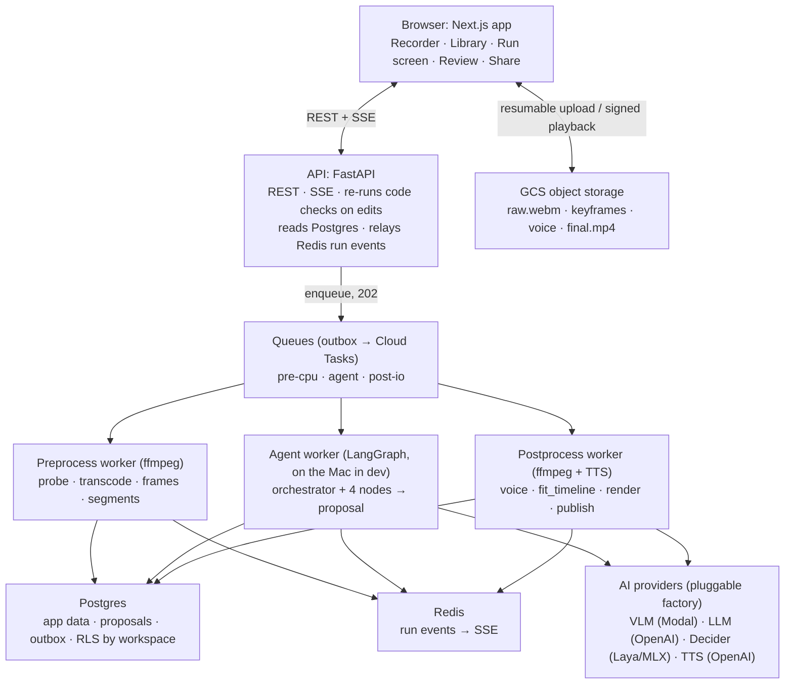
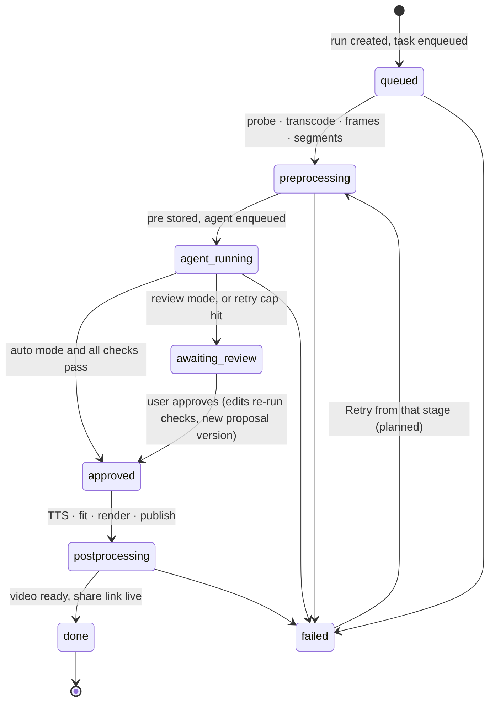
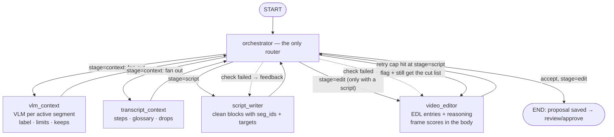

# Stepwise (ai-video-cleaner)

Record your screen in the browser; an AI agent proposes a cleaned script and a cut plan; you review it (or auto-approve); the app renders a cleaned video with an optional AI voiceover and a Loom-style share link.

**Stack:** Next.js + TypeScript (frontend) · FastAPI + Pydantic (API) · LangGraph (agent core only) · Python + ffmpeg workers · Postgres 16 · Redis · GCS · Cloud Tasks · Cloud Run · SSE.

## Design architecture

The browser talks to only two things: the API for control and GCS for media. Everything slow runs in queued workers. The agent worker is the only part with AI decisions; the other workers are plain code. No media bytes ever pass through the API.



A request becomes an outbox row in the same transaction as the state change; workers poll and claim tasks. Status flows back to the browser as SSE events through Redis.

### Run lifecycle

Every arrow is a compare-and-set on `runs.status`, enforced by the `run_transitions` trigger. All status changes go through `lifecycle.advance` — never direct SQL from request code.



## Agent architecture

The graph holds only the agent part; pre- and postprocessing are plain code, and review lives outside the graph (the proposal is saved to the DB first, approval enqueues postprocessing). One graph run = one LangGraph thread (`thread_id = run_id`), durability `sync`. Only URIs and small JSON travel in the state, never media.



### How the orchestrator decides

1. **Code checks first (exact, free):** `length_fit`, `glossary_kept`, `coverage_order`, `nothing_invented`, `clean_only` (script) and `edl_valid`, `edl_covers_script` (edit plan). A failed check routes to the responsible node with the failing messages as feedback — routed to a node that still has retry budget.
2. **Decider verdict** (Laya on MLX, local): "is this ready for the next stage?" Only consulted when all checks pass.
3. **LLM critique, only on rejection.**

Key invariants:

- `END` is only legal from the **edit** stage: a proposal that leaves the graph is complete (script **and** cut list), or the run fails loudly instead of parking an unapprovable review.
- A capped stage never blocks another stage's feedback loop: the editor gets its own retries even if the writer gave up.
- `max_attempts` (3) per stage; a capped proposal is flagged `max_attempts` and still lands on review for the human to fix.
- The API imports the same check functions, so the review screen re-runs them on every user edit.

### Review (outside the graph)

The proposal is versioned in Postgres (`agent` source, then `user` per edit). Only block text, cut/speed/freeze and `must_keep` are user-editable; every save re-runs the checks; approve is a checked transition that enqueues postprocessing.

## Local development

Four processes + docker compose (see `docs/setup/local-agent.md` for the full walkthrough):

```bash
docker compose up -d                     # Postgres, Redis, fake GCS
docker compose --profile media up -d     # ffmpeg preprocess/render worker
cd backend && uv sync
uv run python scripts/migrate.py --dev-passwords
uv run uvicorn app.main:app --reload --port 8000   # API
uv run python -m app.pipeline.mac_agent            # agent + Laya on the Mac
cd frontend && npm install && npm run dev           # UI on :3000
```

`backend/.env` (git-ignored, see `backend/.env.example`): `OPENAI_API_KEY` for chat/speech, `GEMMA_BASE_URL` + `GEMMA_MODEL` + Modal proxy-token pair (or `GEMMA_API_KEY`) for the VLM. Never run `pytest` while the dev API/worker is up — they share the local database.

## Where things live

| Path | What |
| --- | --- |
| `docs/plan/phases.md` | Build order and the current phase's exit criteria — work only on the current phase |
| `docs/design/hld-lld.md` | Architecture source of truth (system, graph, schema, API) |
| `docs/design/sql/` | Tested schema, RLS policies, isolation tests |
| `backend/app/<domain>/` | One package per domain: `router.py` + `schemas.py`, plus `shared/`, `contracts/`, `pipeline/`, `agent/`, `providers/` |
| `backend/app/runs/lifecycle.py` | The only writer of run status (compare-and-set, trigger-checked) |
| `frontend/src/features/` | Recorder, library, run screen, review — layout rules enforced by `frontend/scripts/check-layout.mjs` |