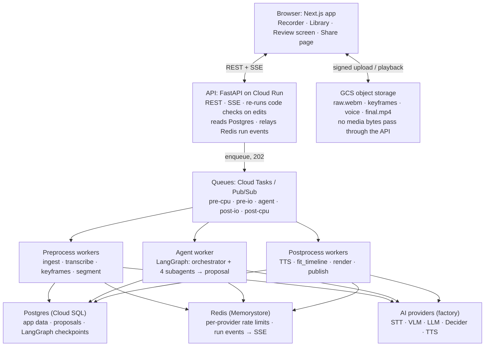
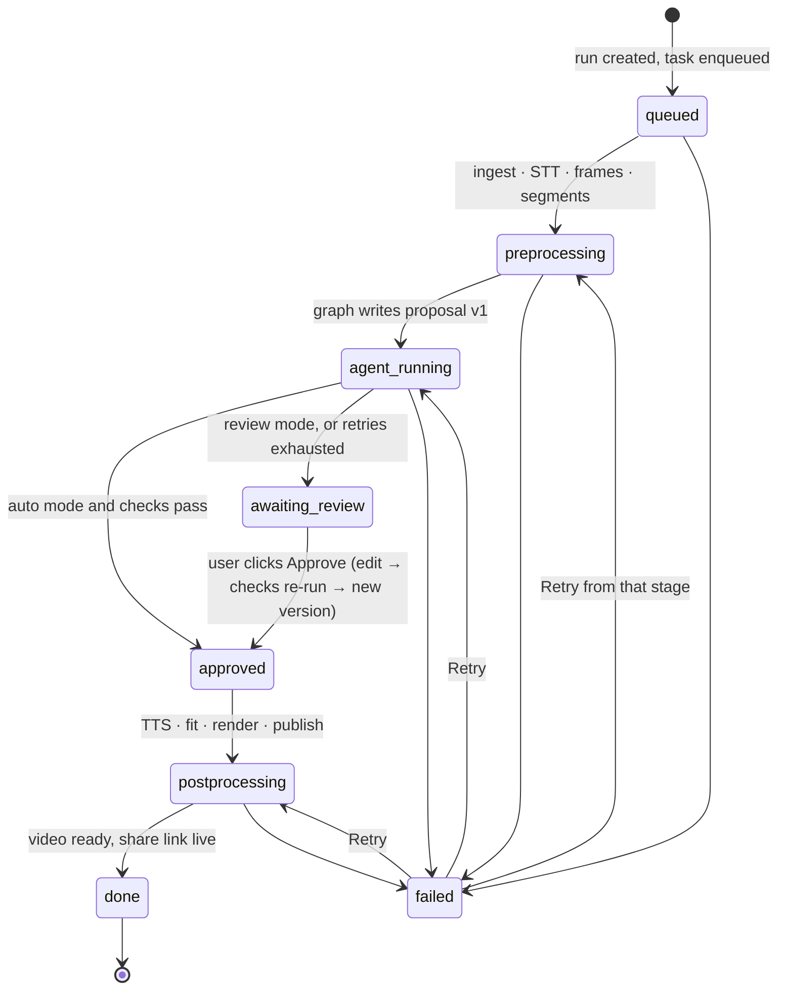
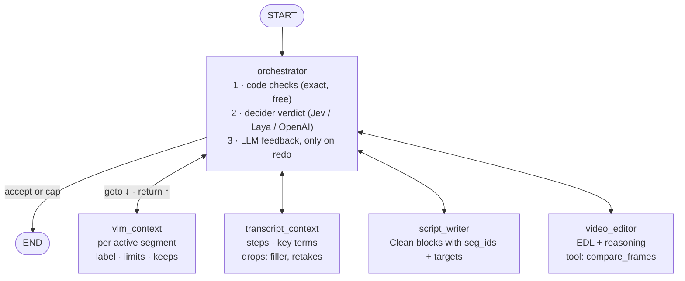

# AI Screen Recording Cleaner — HLD & LLD (v1)

Exported from the [Claude Doc](https://claude.ai/code/artifact/e84e1b9f-66ba-4c71-8061-0d1961b7db5c) on 2026-10-17 (rev 18). This file is now the source of truth; edit it here.

## Overview

v1 records a screen in the browser. An agent then proposes a cleaned narration script and a cut plan, and the user reviews it or has it approved automatically. The app then renders the video and shares it by link. The product is inspired by [Trupeer](https://www.trupeer.ai/), but v1 is scoped to this one loop.

**In v1:** web recorder (screen + mic), upload, Loom-style share link, a "Process with AI" button that produces a cleaned video, the review screen, and a voice setting (original audio or stock AI voice).

**Not in v1:** Chrome extension, docs/SOP output, translation, zooms and animations, avatars, voice cloning, embeddings and knowledge base, and the "Polish" script style.

### Decisions locked in the brainstorm (15–16 Oct 2026)

| # | Area | Decision |
| --- | --- | --- |
| 1 | Platform | Web app first (like Loom's web recorder); Chrome extension later |
| 2 | v1 output | AI-cleaned video shared by link; docs later, as a feature |
| 3 | Core loop | Transcribe, rewrite the script, voice it (or keep the original audio), fit the video, share |
| 4 | User control | Per run: review mode or auto mode; both produce the same proposal |
| 5 | Graph scope | LangGraph holds only the agent part; preprocessing and postprocessing are plain code |
| 6 | Agent pattern | Orchestrator + subagents (vlm\_context, transcript\_context, script\_writer, video\_editor), routing via `Command` |
| 7 | Orchestrator role | Fixed first pass; it reviews each output and decides accept, redo (with feedback) or end; retries are capped |
| 8 | How the orchestrator reviews | Code checks first, then a decision model (Jev/Laya/OpenAI Decisions) gives the verdict, and an LLM writes feedback only on a "redo" |
| 9 | Retries exhausted | The run goes to the review screen with the failing blocks highlighted |
| 10 | Where review lives | Outside the graph: the graph writes a proposal and ends; review, approval and postprocessing are app features |
| 11 | Segment labels | Free-text label + reasoning from the VLM; fixed numeric output shape; global hard limits in code; static segments labelled `idle` by code |
| 12 | Script style | Clean only: keep the user's words and order, remove filler, false starts and retakes |
| 13 | Retake cuts | The agent decides keep or cut, using a `compare_frames` tool; code enforces only mechanical limits |
| 14 | Voice | A setting: original audio (cut only) or stock AI voice; cloning later |
| 15 | Providers | Pluggable provider factory: self-hosted or third-party, one interface per stage |
| 16 | Stack | Next.js + TS, FastAPI, LangGraph, Python/ffmpeg workers, Cloud Tasks/PubSub, Redis, Postgres, GCS, Cloud Run, SSE |

## HLD: system architecture

The browser talks to only two things: the API for control and GCS for media. Everything slow runs in queued workers that share Postgres, Redis and the provider factory. The agent worker is the only part with AI decisions; the other workers are plain code.


_The browser talks only to the API and GCS; heavy work runs in queued workers._

Read it top down: a request becomes a queued task, a worker does the work, and status flows back to the browser as SSE events through Redis.

## HLD: end-to-end flow

One recording becomes a shared video in eight steps. The only pause for a human is the review screen, and it sits outside the agent graph.

1. **Record:** the browser captures screen + mic with `getDisplayMedia` and `MediaRecorder` (WebM).
2. **Upload:** `POST /videos` returns a resumable GCS upload URL; the browser uploads directly, then calls `/uploaded`. The user can stop here and share the raw video, Loom-style. Because the PUT is cross-origin, the real GCS bucket needs a CORS config (origin = `FRONTEND_BASE_URL`, methods `PUT`, `responseHeader` `["Content-Type", "Range"]` so the recorder can read the 308 `Range`) and the session should be created with that `Origin`; local fake-gcs already allows any origin but exposes only `Location`, so the recorder assumes a 308 without a readable `Range` persisted the whole chunk.
3. **Process with AI:** `POST /videos/{id}/runs` with `{mode, voice}` returns `202 {run_id}` and enqueues preprocessing.
4. **Preprocess (code):** ingest, transcribe and keyframes, then segment, stored as `runs.pre`.
5. **Agent (graph):** the orchestrator and subagents produce a proposal; the worker saves it as proposal v1 and the graph ends.
6. **Gate (app):** auto mode with all checks passing approves automatically; review mode or exhausted retries go to the review screen.
7. **Postprocess (code):** voice, fit\_timeline, render, then publish to the video's `output_uri`.
8. **Share:** the user creates a share link; viewers get a signed playback URL.

If the user stays on the page, SSE events update it live. If they leave, the library shows the status, and the finished video appears there.


_Every run ends in one proposal; only approval unlocks rendering. Any active status can also move to cancelled (not drawn). The full list of legal moves is the `run_transitions` table._

Run statuses map one-to-one to the `run_status` enum in the schema. Every arrow is a compare-and-set on `runs.status`.

## LLD: agent graph

The graph turns a preprocessed recording into a **proposal** (script blocks + an edit decision list (EDL) + flags) and then ends. One graph run = one LangGraph thread, with `thread_id = run_id`, on a Postgres checkpointer. Only storage paths (URIs) and small JSON go in the state, never media.


_The orchestrator is the only router; every subagent hands back to it. Stages: context (vlm_context + transcript_context in parallel) → script → edit. Redo = goto the same subagent with feedback; after max_attempts (3) per stage, END with flags and the run goes to review._

The stages run in a fixed order (context, then script, then edit). The orchestrator's choice is only accept, redo or end at each stage.

### Nodes

| Node | Model | Reads | Writes |
| --- | --- | --- | --- |
| `orchestrator` | Code checks, then Decider, then LLM (only on redo) | Whole state | `Command(goto=…, update={feedback, attempts, stage, flags})` |
| `vlm_context` | VLM (Gemma 4 or a hosted VLM), called for each active segment in parallel | Segments, keyframe URIs, transcript slice | `seg_contexts[]` |
| `transcript_context` | LLM | Words with timestamps | `transcript_ctx` (steps, key terms, drops) |
| `script_writer` | LLM | `transcript_ctx`, `seg_contexts`, feedback | `script` (blocks with `seg_ids`, target min/max) |
| `video_editor` | LLM + `compare_frames` tool | `script`, `seg_contexts`, keyframes, feedback | `edit_plan` (EDL + reasoning per segment) |

### Control flow

1. `START` goes to `orchestrator` with `stage=context`. It fans out to `vlm_context` and `transcript_context` in parallel; static segments are labelled `idle` by code first and skip the VLM.
2. Both return to `orchestrator`, which sends the run to `script_writer` (`stage=script`).
3. `script_writer` returns. The orchestrator reviews: on accept it sends the run to `video_editor`; on redo it sends it back to `script_writer` with feedback.
4. `video_editor` returns. The orchestrator reviews: on accept it goes to `END`; on redo it sends the run back to `video_editor` or `script_writer` with feedback.
5. If any stage reaches the retry cap, the orchestrator goes to `END` with flags, and the app routes the run to review.

Every subagent has one static edge back to `orchestrator`. The orchestrator routes only through its `Command` return type and has no static edges.

### How the orchestrator reviews

```python
def orchestrator(state: AgentState, runtime: Runtime[Ctx]) -> Command[Literal[
        "vlm_context", "transcript_context", "script_writer", "video_editor", "__end__"]]:
    if state.stage == "context":
        return Command(goto=["vlm_context", "transcript_context"], update={"stage": "script"})

    target = "script_writer" if state.stage == "script" else "video_editor"
    fails = [r for r in run_checks(state, runtime.context) if not r.passed]   # 1. code: exact, free
    if fails:
        return redo_or_end(state, fails[0].target, [f.message for f in fails])

    v = runtime.context.providers.decider.yes_no(QUESTION[target], ctx=summarise(state))  # 2. decider
    if v.p_yes >= runtime.context.accept_threshold:
        return advance(state)            # script → video_editor, edit → END

    critique = runtime.context.providers.llm.critique(target, state)                 # 3. LLM, only on redo
    return redo_or_end(state, target, [critique])
```

`redo_or_end` increments `attempts[target]`. At `max_attempts` (default 3) it goes to `END` with a flag; otherwise it goes to `target` with the feedback.

### Code checks

| Check | On | Fails when | Feedback goes to |
| --- | --- | --- | --- |
| Length fit | Each script block | Words ÷ voice words-per-second falls outside the sum of `min_dur`…`max_dur` over its segments | `script_writer` |
| Key terms kept | Each block | A key term spoken in the source slice is missing from the block | `script_writer` |
| Coverage and order | Script | An active segment is unused, a segment is in two blocks, or blocks are out of order | `script_writer` |
| Nothing invented | Each block | A number, URL or quoted UI label appears in neither the transcript nor `screen_text` | `script_writer` |
| Clean only | Each block | In original-audio mode, any word not in the source transcript | `script_writer` |
| EDL valid | Edit plan | Times outside the video, overlaps, speed > `max_speed` (2.0) or a duration < `min_dur` (0.3 s) | `video_editor` |
| EDL covers script | Edit plan | Edited duration of a block's segments ≠ its estimated speech duration ± tolerance | `video_editor` |

The API imports the same check functions, so the review screen re-runs them on every user edit.

### Graph wiring

```python
b = StateGraph(AgentState, context_schema=Ctx)
b.add_node("orchestrator", orchestrator)
b.add_node("vlm_context", vlm_context, retry_policy=RetryPolicy(max_attempts=3))
b.add_node("transcript_context", transcript_context, retry_policy=RetryPolicy(max_attempts=3))
b.add_node("script_writer", script_writer, retry_policy=RetryPolicy(max_attempts=3))
b.add_node("video_editor", video_editor, retry_policy=RetryPolicy(max_attempts=3))
b.add_edge(START, "orchestrator")
for n in ["vlm_context", "transcript_context", "script_writer", "video_editor"]:
    b.add_edge(n, "orchestrator")
graph = b.compile(checkpointer=PostgresSaver.from_conn_string(DB_URL))
```

`RetryPolicy` covers transient provider errors (429/5xx) inside a node. It is separate from the orchestrator's quality retries.

## LLD: preprocessing and postprocessing

Both pipelines are plain Python workers with no agent decisions. Preprocessing turns a raw WebM into data the agents can reason over. Postprocessing turns an approved proposal into a finished MP4.

### Preprocessing (queue `pre-cpu`, then `pre-io`)

| Step | Does | Output | Pool |
| --- | --- | --- | --- |
| `ingest` | `ffprobe`; transcode WebM to an H.264 MP4 at a constant frame rate (source fps kept); extract mono 16 kHz WAV | `mezz_uri`, `audio_uri`, duration, fps, size | CPU |
| `transcribe` | Speech-to-text with **word timestamps** via the `Transcriber` provider | `words[]` | IO |
| `sample_frames` | Keyframes at a 1 fps baseline **plus** extra frames where the frame difference spikes; JPEGs to GCS; a difference score per frame | `keyframes[]` | CPU |
| `segment` | Boundaries at speech pauses ≥ `pause_ms` combined with scene changes; length clamped to 2–15 s; `active = max diff > ε`; static segments labelled `idle` | `segments[]` | CPU |

`transcribe` and `sample_frames` run in parallel after `ingest`. The result is one `PreprocessResult`, stored on the run (`runs.pre`), and it becomes the graph's input. `pause_ms` and `ε` are values to tune on real recordings.

### Postprocessing (after approval; queues `post-io`, then `post-cpu`)

| Step | AI voice mode | Original-audio mode |
| --- | --- | --- |
| `voice` | TTS for each block in parallel; measure real duration and keep alignment data | Cut the original WAV by the approved `drops`; no TTS |
| `fit_timeline` | Solver: real audio duration vs each segment's `min_dur`/`max_dur`/`must_keep`. Order: trim cuttable frames, then speed up (≤ `max_speed`), then freeze the last frame. Narration is never sped up | Same solver; the audio is already the target length |
| `render` | ffmpeg: trim and `setpts` per EDL entry, `tpad` for freezes, concat, mux the narration; produce the MP4 + a poster frame | Same |
| `publish` | Write `output_uri`, mark the video `ready`, emit `run.done` | Same |

`fit_timeline` is a pure function with unit tests. It is the last line of defence when real TTS durations differ from the script's estimates.

### Storage layout (fixed paths, so a retry overwrites instead of duplicating)

```
gs://<bucket>/videos/{video_id}/raw.webm
gs://<bucket>/videos/{video_id}/poster.jpg      # browser-made at stop (phase 2); preprocess may replace it
gs://<bucket>/runs/{run_id}/pre/mezz.mp4 | audio.wav | frames/{frame_id}.jpg
gs://<bucket>/runs/{run_id}/post/v{proposal_version}/voice/{block_id}.mp3
gs://<bucket>/runs/{run_id}/post/v{proposal_version}/final.mp4 | poster.jpg
```

## Schema: Postgres

Postgres holds entities and status in plain tables, agent output in JSONB, and the LangGraph checkpoints (created by `PostgresSaver.setup()`). pgvector is added later for the knowledge base. A `run` is one "Process with AI" attempt on a video; its id is also the LangGraph `thread_id`.

| Table | Purpose | Key relations |
| --- | --- | --- |
| `users` | Accounts | — |
| `workspaces`, `workspace_members` | Tenancy and roles | user ↔ workspace |
| `videos` | One recording and its current output | workspace, owner |
| `runs` | One processing attempt: mode, voice, status, preprocess result | video |
| `proposals` | Versioned agent or user proposal (script, EDL, contexts, checks) | run |
| `review_edits` | Each human correction (agent value to user value): future training data | proposal, user |
| `shares` | Share links and visibility | video |
| `provider_calls` | Cost, latency and errors per provider call | run |
| `run_transitions` | Legal status moves, enforced by a trigger | runs (trigger) |
| `outbox` | Queue tasks committed with the state change, drained by the relay | workspace, run |

```sql
-- Schemas: public = app tables (RLS on), app = helper functions, lg = LangGraph checkpoints (workers only)
create extension if not exists citext;
create schema if not exists app;
create schema if not exists lg;

create type member_role   as enum ('owner','admin','member');
create type video_status  as enum ('uploading','uploaded','processing','awaiting_review','rendering','ready','failed');
create type run_mode      as enum ('review','auto');
create type voice_mode    as enum ('original','ai');
create type run_status    as enum ('queued','preprocessing','agent_running','awaiting_review',
                                   'approved','postprocessing','done','failed','cancelled');
create type proposal_src  as enum ('agent','user');
create type share_vis     as enum ('private','workspace','link');
create type edit_kind     as enum ('block_text','cut_toggle','speed','must_keep');

create table users (
  id          uuid primary key default gen_random_uuid(),
  email       citext unique not null,
  name        text,
  created_at  timestamptz not null default now()
);

create table workspaces (
  id          uuid primary key default gen_random_uuid(),
  name        text not null check (length(name) between 1 and 120),
  settings    jsonb not null default '{}',   -- default mode, voice, accept threshold
  created_at  timestamptz not null default now()
);

create table workspace_members (
  workspace_id uuid not null references workspaces on delete cascade,
  user_id      uuid not null references users on delete cascade,
  role         member_role not null default 'member',
  primary key (workspace_id, user_id)
);
create index on workspace_members (user_id, workspace_id);     -- the RLS membership lookup

create table videos (
  id              uuid primary key default gen_random_uuid(),
  workspace_id    uuid not null references workspaces on delete cascade,
  owner_id        uuid not null references users,
  title           text not null default 'Untitled recording',
  status          video_status not null default 'uploading',
  raw_uri         text,
  duration_s      numeric(8,2) check (duration_s > 0),
  width int check (width > 0), height int check (height > 0), fps numeric(6,3) check (fps > 0),
  current_run_id  uuid,                        -- fk added after runs
  output_uri      text,
  poster_uri      text,
  created_at      timestamptz not null default now(),
  updated_at      timestamptz not null default now(),
  unique (workspace_id, id),                   -- target for child composite FKs
  check (status not in ('uploaded','processing','awaiting_review','rendering','ready') or raw_uri is not null),
  check (status <> 'ready' or output_uri is not null)
);
create index on videos (workspace_id, created_at desc);

create table runs (
  id            uuid primary key default gen_random_uuid(),   -- = LangGraph thread_id
  workspace_id  uuid not null,
  video_id      uuid not null,
  created_by    uuid not null references users,
  mode          run_mode not null,
  voice         voice_mode not null,
  voice_id      text,                          -- provider voice when voice = 'ai'
  status        run_status not null default 'queued',
  stage         text,                          -- fine-grained step for the UI
  attempt       int not null default 1 check (attempt >= 1),  -- bumped by the Retry button
  pre           jsonb,                         -- PreprocessResult
  flags         jsonb not null default '[]',
  error         jsonb,
  created_at    timestamptz not null default now(),
  started_at    timestamptz,
  finished_at   timestamptz,
  foreign key (workspace_id, video_id) references videos (workspace_id, id) on delete cascade,
  unique (workspace_id, id),
  unique (video_id, id),                       -- target for videos.current_run_id
  check ((voice = 'ai') = (voice_id is not null)),
  check ((status in ('done','failed','cancelled')) = (finished_at is not null))
);
create index on runs (video_id, created_at desc);
create index runs_active on runs (status) where status not in ('done','failed','cancelled');
-- at most one live run per video: a double-click on "Process with AI" cannot start two
create unique index runs_one_live_per_video on runs (video_id)
  where status not in ('done','failed','cancelled');
-- current_run_id must point at a run of the same video; deferred so video + run can be created in one transaction
alter table videos add foreign key (id, current_run_id) references runs (video_id, id)
  deferrable initially deferred;

-- legal status moves; a trigger rejects anything else, so a buggy worker cannot skip states
create table run_transitions (
  from_status run_status not null,
  to_status   run_status not null,
  primary key (from_status, to_status)
);
insert into run_transitions values
  ('queued','preprocessing'), ('preprocessing','agent_running'),
  ('agent_running','awaiting_review'), ('agent_running','approved'),      -- auto mode
  ('awaiting_review','approved'), ('approved','postprocessing'), ('postprocessing','done'),
  ('queued','failed'), ('preprocessing','failed'), ('agent_running','failed'), ('postprocessing','failed'),
  ('queued','cancelled'), ('preprocessing','cancelled'), ('agent_running','cancelled'),
  ('awaiting_review','cancelled'), ('approved','cancelled'),
  ('failed','preprocessing'), ('failed','agent_running'), ('failed','postprocessing');   -- Retry

create function app.check_run_transition() returns trigger language plpgsql as $$
begin
  if new.status is distinct from old.status and not exists (
       select 1 from run_transitions where from_status = old.status and to_status = new.status) then
    raise exception 'illegal run transition % -> %', old.status, new.status using errcode = 'check_violation';
  end if;
  return new;
end $$;
create trigger runs_transition before update of status on runs
  for each row execute function app.check_run_transition();

create table proposals (
  id                 uuid primary key default gen_random_uuid(),
  workspace_id       uuid not null,
  run_id             uuid not null,
  version            int  not null check (version >= 1),
  source             proposal_src not null,
  script             jsonb not null,           -- Script
  edit_plan          jsonb not null,           -- EditPlan (EDL + reasoning)
  seg_contexts       jsonb not null,           -- list[SegContext]
  transcript_ctx     jsonb not null,           -- TranscriptContext
  checks             jsonb not null,           -- list[CheckResult]
  approved_by        uuid references users,
  approved_at        timestamptz,
  created_at         timestamptz not null default now(),
  foreign key (workspace_id, run_id) references runs (workspace_id, id) on delete cascade,
  unique (run_id, version),                    -- makes "save proposal" idempotent (not deferrable: ON CONFLICT arbiter)
  unique (workspace_id, id),
  check ((approved_by is null) = (approved_at is null)),
  check (source = 'user' or version = 1)       -- only v1 comes from the agent
);
create unique index proposals_one_approved on proposals (run_id) where approved_at is not null;

create table review_edits (
  id           bigint generated always as identity primary key,
  workspace_id uuid not null,
  proposal_id  uuid not null,
  user_id      uuid not null references users,
  kind         edit_kind not null,
  target_id    text not null,                  -- block_id or seg_id
  agent_value  jsonb,
  user_value   jsonb,
  created_at   timestamptz not null default now(),
  foreign key (workspace_id, proposal_id) references proposals (workspace_id, id) on delete cascade
);
create index on review_edits (proposal_id);

create table shares (
  id           uuid primary key default gen_random_uuid(),
  workspace_id uuid not null,
  video_id     uuid not null,
  slug         text unique not null check (slug ~ '^[A-Za-z0-9_-]{10,32}$'),
  visibility   share_vis not null default 'link',
  expires_at   timestamptz,
  created_by   uuid not null references users,
  view_count   bigint not null default 0 check (view_count >= 0),
  created_at   timestamptz not null default now(),
  foreign key (workspace_id, video_id) references videos (workspace_id, id) on delete cascade
);
create index on shares (video_id);

create table provider_calls (
  id           bigint generated always as identity primary key,
  workspace_id uuid not null references workspaces on delete cascade,
  run_id       uuid,
  stage        text not null,                  -- transcribe | vlm_context | tts | ...
  provider     text not null,
  model        text,
  units        numeric check (units >= 0),     -- seconds of audio, tokens, characters
  cost_usd     numeric(10,5) check (cost_usd >= 0),
  latency_ms   int check (latency_ms >= 0),
  ok           boolean not null,
  error        text,
  created_at   timestamptz not null default now(),
  foreign key (workspace_id, run_id) references runs (workspace_id, id) on delete set null (run_id)  -- PG 15+
);
create index on provider_calls (workspace_id, created_at desc);
create index on provider_calls (run_id);

-- transactional outbox: rows written in the same transaction as the state change they announce
create table outbox (
  id            bigint generated always as identity primary key,
  workspace_id  uuid not null references workspaces on delete cascade,
  run_id        uuid not null,
  queue         text not null check (queue in ('pre-cpu','pre-io','agent','post-io','post-cpu')),
  task_id       text not null unique,          -- sha256(run_id:stage:attempt), also the Cloud Tasks task id
  payload       jsonb not null,
  created_at    timestamptz not null default now(),
  sent_at       timestamptz,
  tries         int not null default 0,
  foreign key (workspace_id, run_id) references runs (workspace_id, id) on delete cascade
);
create index outbox_unsent on outbox (id) where sent_at is null;

-- updated_at maintained by the database, not by callers
create function app.touch_updated_at() returns trigger language plpgsql as $$
begin new.updated_at := now(); return new; end $$;
create trigger videos_touch before update on videos
  for each row execute function app.touch_updated_at();

-- LangGraph checkpoints: PostgresSaver.setup() runs in the migration job with search_path = lg
grant usage on schema lg to app_worker;
grant select, insert, update, delete on all tables in schema lg to app_worker;
```

Every tenant table carries `workspace_id`, tied to its parent by a composite foreign key such as `(workspace_id, video_id) → videos (workspace_id, id)`. A row therefore cannot sit in a different workspace than its parent, and RLS policies need no joins. Status changes are compare-and-set updates checked by the `runs_transition` trigger; the next two sections cover RLS and transactions.

## Schema: tenancy and RLS

Every table has row-level security enabled and forced, and no application role can bypass it, so a query that forgets its `WHERE workspace_id` still returns only the caller's rows. The schema and policies below ran on Postgres 16, and 26 isolation and integrity checks pass (listed at the end of this section; `backend/scripts/check_db.py` runs them in CI).

### Database roles

| Role | Login | Used by | Identity it sets | Can see |
| --- | --- | --- | --- | --- |
| `app_owner` | No | Migrations (`SET ROLE`) | — | Nothing at runtime: `FORCE` applies policies to the owner too |
| `app_api` | Yes | FastAPI | `app.user_id` | Rows in workspaces the user belongs to |
| `app_worker` | Yes | Pre, agent and post workers | `app.workspace_id`, from the task | Rows of the one workspace named in the task, plus the `lg` checkpoint schema |
| `app_relay` | Yes | Outbox relay | — | The outbox only |
| `app_definer` | No | Owns 5 `SECURITY DEFINER` functions | — | Only what each function needs, through its own policy |

No role has `BYPASSRLS`. Cloud SQL gives no true superuser ([Cloud SQL users](https://docs.cloud.google.com/sql/docs/postgres/users)), and the app never connects as `postgres`. Whether `cloudsqlsuperuser` bypasses RLS is undocumented, so check it on the instance with `select rolname, rolbypassrls from pg_roles`.

### How identity reaches Postgres

Each API request is one transaction that sets the user with `set_config(..., true)`. That value ends with the transaction whether it commits or rolls back ([SET](https://www.postgresql.org/docs/current/sql-set.html)), so it is safe with transaction pooling. Session-level `SET` is banned because PgBouncer's transaction mode does not support it ([PgBouncer features](https://www.pgbouncer.org/features.html)).

```python
@asynccontextmanager
async def tenant_tx(user_id: UUID):              # FastAPI dependency; workers use app.workspace_id
    async with pool.connection() as conn, conn.transaction():
        await conn.execute("select set_config('app.user_id', %s, true)", (str(user_id),))
        yield conn
```

Identity fails closed. Tested: once a connection has used `app.user_id`, `current_setting('app.user_id', true)` reads back as `''` rather than NULL, and as NULL if never set. The helpers wrap it in `nullif(..., '')`, so a missing identity matches no rows.

### Policies

| Table | API (user) | Worker (one workspace) | Other |
| --- | --- | --- | --- |
| `users` | Read self and co-members; update own name | — | Sign-in through `app.ensure_user` |
| `workspaces` | Read if member; update if owner or admin | Read | Created through `app.create_workspace`, which adds the creator as owner in the same transaction |
| `workspace_members` | Read if member; manage if owner or admin; leave self | — | `app_definer` reads it for membership checks |
| `videos` | Read, insert (as owner) and update if member; delete if owner or admin | Read, update | Public page through `app.resolve_share` |
| `runs` | Read, insert (as creator) and update if member | Read, update | Status trigger allows only listed moves |
| `proposals` | Read; insert only `source='user'`; approve only as self | Read, insert (agent v1) | — |
| `review_edits` | Read; insert as self; no update or delete grant | — | Append-only training data |
| `shares` | Read and write if member | — | — |
| `provider_calls` | Read if owner or admin | Read, insert | — |
| `outbox` | Insert | Insert | Relay reads and marks sent, across workspaces |

RLS narrows rows and `GRANT` narrows verbs and columns, so the API cannot, for example, rewrite `runs.pre` or delete a review edit. Membership checks go through `SECURITY DEFINER` helpers. Their `search_path` is pinned and ends with `pg_temp` ([CREATE FUNCTION](https://www.postgresql.org/docs/current/sql-createfunction.html)), and they are wrapped in `(select ...)` so they run once per query, not once per row ([Supabase RLS performance](https://supabase.com/docs/guides/database/postgres/row-level-security)).

```sql
-- ROLES. No app role has BYPASSRLS; the owner is NOLOGIN and FORCE makes even it obey policies.
create role app_owner   nologin;                -- owns tables; migrations run as it (SET ROLE)
create role app_definer nologin;                -- owns the SECURITY DEFINER functions, each with its own narrow policy
create role app_api     login;                  -- FastAPI; identity = app.user_id
create role app_worker  login;                  -- pre/agent/post workers; identity = app.workspace_id
create role app_relay   login;                  -- outbox relay; sees only the outbox

-- identity from transaction-local settings; unset or '' -> NULL -> every policy is false (fail closed)
create function app.uid()  returns uuid language sql stable
  as $$ select nullif(current_setting('app.user_id', true), '')::uuid $$;
create function app.wsid() returns uuid language sql stable
  as $$ select nullif(current_setting('app.workspace_id', true), '')::uuid $$;

-- membership helpers run as app_definer so the workspace_members policy does not recurse into itself
create function app.my_workspaces() returns setof uuid
  language sql stable security definer set search_path = pg_catalog, public, pg_temp
  as $$ select workspace_id from public.workspace_members where user_id = app.uid() $$;
create function app.has_role(ws uuid, roles member_role[]) returns boolean
  language sql stable security definer set search_path = pg_catalog, public, pg_temp
  as $$ select exists (select 1 from public.workspace_members
                       where workspace_id = ws and user_id = app.uid() and role = any (roles)) $$;

-- sign-in and workspace creation need rows before membership exists
create function app.ensure_user(p_email citext, p_name text) returns uuid
  language sql volatile security definer set search_path = pg_catalog, public, pg_temp
  as $$ insert into public.users (email, name) values (p_email, p_name)
        on conflict (email) do update set name = coalesce(excluded.name, users.name)
        returning id $$;
create function app.create_workspace(p_name text) returns uuid
  language plpgsql volatile security definer set search_path = pg_catalog, public, pg_temp as $$
declare ws uuid;
begin
  if app.uid() is null then raise exception 'no user' using errcode = 'insufficient_privilege'; end if;
  insert into public.workspaces (name) values (p_name) returning id into ws;
  insert into public.workspace_members (workspace_id, user_id, role) values (ws, app.uid(), 'owner');
  return ws;
end $$;

-- public share page: anonymous viewer; returns only playback fields and counts the view atomically
create function app.resolve_share(p_slug text)
  returns table (video_id uuid, title text, output_uri text, poster_uri text)
  language sql volatile security definer set search_path = pg_catalog, public, pg_temp as $$
  update public.shares s set view_count = s.view_count + 1
  from public.videos v
  where s.slug = p_slug and s.visibility = 'link'
    and (s.expires_at is null or s.expires_at > now())
    and v.id = s.video_id and v.status = 'ready'
  returning v.id, v.title, v.output_uri, v.poster_uri $$;

alter function app.my_workspaces()              owner to app_definer;
alter function app.has_role(uuid, member_role[]) owner to app_definer;
alter function app.ensure_user(citext, text)     owner to app_definer;
alter function app.create_workspace(text)       owner to app_definer;
alter function app.resolve_share(text)          owner to app_definer;
revoke execute on all functions in schema app from public;
grant usage on schema app to app_api, app_worker, app_relay, app_definer;
grant execute on function app.uid(), app.wsid() to app_api, app_worker, app_definer;
grant execute on function app.my_workspaces(), app.has_role(uuid, member_role[]),
                          app.ensure_user(citext, text), app.create_workspace(text),
                          app.resolve_share(text) to app_api;

-- OWNERSHIP + RLS ON EVERY TABLE
do $$
declare t text;
begin
  foreach t in array array['users','workspaces','workspace_members','videos','runs','run_transitions',
                           'proposals','review_edits','shares','provider_calls','outbox'] loop
    execute format('alter table public.%I owner to app_owner', t);
    execute format('alter table public.%I enable row level security', t);
    execute format('alter table public.%I force row level security', t);
  end loop;
end $$;

-- TABLE PRIVILEGES (RLS narrows rows; GRANT narrows verbs and columns)
revoke all on all tables in schema public from public;
grant usage on schema public to app_api, app_worker, app_relay, app_definer;
grant select, update (name)                             on users             to app_api;
grant select, update (name, settings)                   on workspaces        to app_api;
grant select, insert, update (role), delete             on workspace_members to app_api;
grant select, insert, update (title, status, raw_uri, duration_s, width, height, fps, current_run_id), delete
                                                        on videos            to app_api;
grant select, insert, update (status, stage, attempt, error, finished_at) on runs to app_api;
grant select                                            on run_transitions   to app_api, app_worker;
grant select, insert, update (approved_by, approved_at) on proposals         to app_api;
grant select, insert                                    on review_edits      to app_api;
grant select, insert, update (visibility, expires_at), delete on shares     to app_api;
grant select                                            on provider_calls    to app_api;
grant insert                                            on outbox            to app_api, app_worker;
grant select                                            on workspaces        to app_worker;
grant select, update                                    on videos, runs      to app_worker;
grant select, insert                                    on proposals, provider_calls to app_worker;
grant select, update (sent_at, tries)                   on outbox            to app_relay;
grant select                                            on workspace_members to app_definer;
grant select, insert, update (name)                     on users             to app_definer;
grant insert, select                                    on workspaces        to app_definer;
grant insert                                            on workspace_members to app_definer;
grant select, update (view_count)                       on shares            to app_definer;
grant select                                            on videos            to app_definer;

-- POLICIES. member(ws) is written as: ws in (select app.my_workspaces())  -- evaluated once per query
create policy rt_read on run_transitions for select to app_api, app_worker using (true);

create policy u_read on users for select to app_api
  using (id = app.uid() or id in (select user_id from workspace_members));   -- members table is itself filtered
create policy u_self on users for update to app_api using (id = app.uid()) with check (id = app.uid());

create policy ws_read  on workspaces for select to app_api using (id in (select app.my_workspaces()));
create policy ws_admin on workspaces for update to app_api
  using (app.has_role(id, '{owner,admin}')) with check (app.has_role(id, '{owner,admin}'));
create policy wm_read  on workspace_members for select to app_api using (workspace_id in (select app.my_workspaces()));
create policy wm_ins   on workspace_members for insert to app_api with check (app.has_role(workspace_id, '{owner,admin}'));
create policy wm_upd   on workspace_members for update to app_api
  using (app.has_role(workspace_id, '{owner,admin}')) with check (app.has_role(workspace_id, '{owner,admin}'));
create policy wm_del   on workspace_members for delete to app_api
  using (app.has_role(workspace_id, '{owner,admin}') or user_id = app.uid());

create policy v_read on videos for select to app_api using (workspace_id in (select app.my_workspaces()));
create policy v_ins  on videos for insert to app_api
  with check (workspace_id in (select app.my_workspaces()) and owner_id = app.uid());
create policy v_upd  on videos for update to app_api
  using (workspace_id in (select app.my_workspaces())) with check (workspace_id in (select app.my_workspaces()));
create policy v_del  on videos for delete to app_api
  using (owner_id = app.uid() or app.has_role(workspace_id, '{owner,admin}'));

create policy r_read on runs for select to app_api using (workspace_id in (select app.my_workspaces()));
create policy r_ins  on runs for insert to app_api
  with check (workspace_id in (select app.my_workspaces()) and created_by = app.uid());
create policy r_upd  on runs for update to app_api
  using (workspace_id in (select app.my_workspaces())) with check (workspace_id in (select app.my_workspaces()));

create policy p_read on proposals for select to app_api using (workspace_id in (select app.my_workspaces()));
create policy p_ins  on proposals for insert to app_api
  with check (workspace_id in (select app.my_workspaces()) and source = 'user');
create policy p_upd  on proposals for update to app_api
  using (workspace_id in (select app.my_workspaces()))
  with check (workspace_id in (select app.my_workspaces()) and approved_by = app.uid());

create policy re_read on review_edits for select to app_api using (workspace_id in (select app.my_workspaces()));
create policy re_ins  on review_edits for insert to app_api
  with check (workspace_id in (select app.my_workspaces()) and user_id = app.uid());

create policy s_read on shares for select to app_api using (workspace_id in (select app.my_workspaces()));
create policy s_ins  on shares for insert to app_api
  with check (workspace_id in (select app.my_workspaces()) and created_by = app.uid());
create policy s_upd  on shares for update to app_api
  using (workspace_id in (select app.my_workspaces())) with check (workspace_id in (select app.my_workspaces()));
create policy s_del  on shares for delete to app_api using (workspace_id in (select app.my_workspaces()));

create policy pc_read on provider_calls for select to app_api using (app.has_role(workspace_id, '{owner,admin}'));
create policy ob_api  on outbox for insert to app_api with check (workspace_id in (select app.my_workspaces()));

-- worker context: one task = one run = one workspace
create policy w_ws on workspaces     for select to app_worker using (id = app.wsid());
create policy w_v  on videos         for all to app_worker using (workspace_id = app.wsid()) with check (workspace_id = app.wsid());
create policy w_r  on runs           for all to app_worker using (workspace_id = app.wsid()) with check (workspace_id = app.wsid());
create policy w_p  on proposals      for all to app_worker using (workspace_id = app.wsid()) with check (workspace_id = app.wsid());
create policy w_pc on provider_calls for all to app_worker using (workspace_id = app.wsid()) with check (workspace_id = app.wsid());
create policy w_ob on outbox         for insert to app_worker with check (workspace_id = app.wsid());

-- relay: drains the outbox across workspaces, nothing else (by GRANT)
create policy rl_read on outbox for select to app_relay using (true);
create policy rl_upd  on outbox for update to app_relay using (true) with check (true);

-- definer functions: each table they touch has a policy for app_definer, scoped to what the function needs
create policy d_wm   on workspace_members for select to app_definer using (true);
create policy d_wm_i on workspace_members for insert to app_definer with check (user_id = app.uid() and role = 'owner');
create policy d_ws_i on workspaces for insert to app_definer with check (true);
create policy d_ws_s on workspaces for select to app_definer using (true);      -- insert ... returning needs it
create policy d_u    on users for all to app_definer using (true) with check (true);
create policy d_s    on shares for select to app_definer
  using (visibility = 'link' and (expires_at is null or expires_at > now()));
create policy d_s_u  on shares for update to app_definer
  using (visibility = 'link' and (expires_at is null or expires_at > now())) with check (true);
create policy d_v    on videos for select to app_definer
  using (status = 'ready' and id in (select video_id from shares));            -- shares filtered by d_s
```

### LangGraph checkpoint tables

`PostgresSaver` keys its rows only by `thread_id`, `checkpoint_ns` and `checkpoint_id`, with no tenant column ([source](https://raw.githubusercontent.com/langchain-ai/langgraph/main/libs/checkpoint-postgres/langgraph/checkpoint/postgres/base.py)). Its four tables (`checkpoints`, `checkpoint_blobs`, `checkpoint_writes`, `checkpoint_migrations`) therefore live in schema `lg`, are granted only to `app_worker`, and are never reachable from the API. A worker opens a thread only after it has read that thread's `runs` row under RLS. `setup()` runs once in the migration job. The worker's checkpoint connection uses `autocommit=True`, `row_factory=dict_row`, `search_path=lg` and, behind PgBouncer transaction mode, `prepare_threshold=None` ([README](https://github.com/langchain-ai/langgraph/blob/main/libs/checkpoint-postgres/README.md)).

### Tests that guard it (Postgres 16, all passing)

| Check | Result |
| --- | --- |
| User in workspace A reads videos, runs, shares, workspaces, users | Only A's rows |
| User A inserts a video into workspace B | Rejected: violates row-level security |
| Request with no identity set | 0 rows everywhere |
| User A updates B's run | 0 rows touched |
| Worker scoped to A reads B's runs or writes a proposal into B | 0 rows, insert rejected |
| Table owner queries with `FORCE` on | 0 rows |
| Relay reads the outbox, then videos | All outbox rows; videos denied |
| API deletes a review edit | Permission denied |
| Live and expired share links through `app.resolve_share` | Live resolves and counts the view; expired returns nothing |
| `create_workspace` with and without a user | Creator becomes owner; anonymous rejected |
| Identity on the same connection after commit | Cleared |
| `app_api` or `app_worker` reads `user_credentials` directly | Permission denied; only `app.credentials_for` returns a hash |
| Second `app.register_credentials` for the same email | Rejected: unique violation |
| Every `public` table has RLS enabled and forced | True (this query runs in CI) |

```sql
-- CI guard: fails the build if any table is missing RLS or FORCE
select relname from pg_class c join pg_namespace n on n.oid = c.relnamespace
where n.nspname = 'public' and c.relkind = 'r' and not (c.relrowsecurity and c.relforcerowsecurity);
```

## Schema: transactions and ACID

Every user action and every stage boundary is one Postgres transaction that changes state and records its follow-up task together. Work outside Postgres (GCS, Cloud Tasks, providers, LangGraph checkpoints) is made idempotent and ordered so that a crash at any point leaves a consistent state.

### How each ACID property is met

| Property | How the design gets it |
| --- | --- |
| Atomicity | Multi-row changes share one transaction (table below). Queue enqueues are rows in `outbox`, written in the same transaction as the state change, so the change and its next task commit or roll back together. |
| Consistency | Rules live in the database, not in callers. Composite foreign keys keep each row's `workspace_id` equal to its parent's. CHECKs cover: AI voice needs `voice_id`; approver and time set together; `finished_at` exactly when terminal; `ready` needs `output_uri`. Partial unique indexes allow one live run per video and one approved proposal per run. A trigger allows only the status moves in `run_transitions`. |
| Isolation | Default READ COMMITTED ([docs](https://www.postgresql.org/docs/current/transaction-iso.html)). Single-row moves are compare-and-set `UPDATE ... WHERE status = $expected`: a concurrent update makes Postgres re-check the `WHERE`, and the loser sees 0 rows. Read-then-write flows (approve) lock the run first with `SELECT ... FOR UPDATE`. The relay claims rows with `FOR UPDATE SKIP LOCKED`. |
| Durability | Cloud SQL regional HA (synchronous standby), automated backups with point-in-time recovery, and `synchronous_commit` left on. A GCS object is always written before the row that points to it, so a committed row never references a missing file. |

### Transaction boundaries

| Operation | One transaction | Outside it, safe because |
| --- | --- | --- |
| `POST /videos` | Insert video (`uploading`) | Resumable upload URL issued after commit |
| `POST /videos/{id}/uploaded` | CAS `uploading → uploaded`, set `raw_uri`, duration, size | Object existence checked in GCS before the transaction |
| `POST /videos/{id}/runs` | Insert run (`queued`), set `videos.current_run_id` and status `processing`, outbox `pre-cpu` task | A second click hits `runs_one_live_per_video` and gets `409` |
| Pre stage finishes (worker) | CAS to the next status, write `runs.pre`, outbox next task | Artifacts already at fixed GCS paths |
| Agent finishes (worker) | Insert proposal v1 with `ON CONFLICT DO NOTHING`, CAS `agent_running → awaiting_review` or `approved` (auto), set video status, outbox `post-io` if approved | Checkpoints commit separately; a replay re-saves v1 as a no-op |
| `PUT /runs/{id}/proposal` | Lock run `FOR UPDATE`, check `awaiting_review`, check `base_version` equals the latest version (else `409 {code: version_conflict, latest_version}`), apply the edit rule, insert proposal vN (`user`) and its `review_edits`, re-run the EDL check | The row lock makes `max(version) + 1` safe |
| `POST /runs/{id}/approve` | Lock run `FOR UPDATE`, check `awaiting_review`, check the optional `base_version` against the latest version (`409 version_conflict`), EDL-check the latest version (`422` if it fails), set its approver, CAS `→ approved`, video `rendering`, outbox `post-io` | `proposals_one_approved` blocks a double approve |
| A stage raises (worker) | Its transaction rolls back; a fresh transaction moves the run to `failed` with `{stage, message, retryable: true}` | The live-run slot is freed, so the video is not blocked |
| Render finishes (worker) | CAS `postprocessing → done`, video `ready` with `output_uri`, `finished_at` | Output written to GCS first |
| Provider call log | Its own autocommit insert | Kept even when the stage rolls back, so cost is never lost |
| Share view | `app.resolve_share`: one `UPDATE ... RETURNING` | Atomic counter |

```python
# app/runs/router.py: the handler only parses, scopes and maps errors
async def approve(run_id: UUID, user_id: CurrentUser) -> RunSummary:
    async with tenant_tx(user_id) as conn:                   # RLS identity + one transaction
        run = await lifecycle.load(conn, run_id)             # SELECT ... FOR UPDATE: read-then-write
        if run is None: raise not_found("run")               # other tenant's run is invisible, so 404
        events = await review.approve(conn, run)             # 409 / 422 come from domain exceptions
    await publish_all(run.id, events)                        # after commit, best effort

# app/runs/review.py
async def approve(conn, run: RunRef) -> list[Event]:
    if run.status != "awaiting_review": raise NotReviewable
    pid, proposal = await latest(conn, run) or raise_(NoProposal)
    check = edl_valid(proposal.edit_plan, proposal.seg_contexts, run.duration_s)
    if not check.passed: raise InvalidEdl(check)             # 422 only when the render would break
    await conn.execute("update proposals set approved_by = app.uid(), approved_at = now() where id = %s", (pid,))
    return await lifecycle.advance(conn, run, "approved")    # CAS + video 'rendering' + outbox post-io
```

Edits are saved before approval by `PUT /runs/{id}/proposal` (`review.save_edit`). Its row lock makes `max(version) + 1` safe, and `unique (run_id, version)` backs it up. SSE events go to Redis after commit and are best-effort, because a client that reconnects refetches status.

### Outbox relay

```sql
-- relay loop: every second, or woken by NOTIFY
begin;
select id, queue, task_id, payload from outbox
 where sent_at is null order by id limit 100
 for update skip locked;
-- for each row: Cloud Tasks create(name = task_id); ALREADY_EXISTS counts as sent
update outbox set sent_at = now(), tries = tries + 1 where id = any($1);
commit;
```

If the relay crashes after creating a task but before commit, it sends the task again, and Cloud Tasks rejects the duplicate name, so each task id is enqueued once. The id is `sha256(run_id:stage:attempt)` for two reasons from the [Cloud Tasks docs](https://docs.cloud.google.com/tasks/docs/reference/rest/v2/projects.locations.queues.tasks/create):

- Sequential ids or prefixes increase latency and error rates.
- A deleted task's id stays reserved for up to 24 hours, so a Retry must carry a new attempt number.

Cloud Tasks can still deliver a task more than once, so every handler starts with its compare-and-set and exits if it loses.

### Long-running stages

Cloud Tasks HTTP tasks time out after at most 30 minutes, and Cloud Run requests after at most 60 ([Cloud Tasks](https://docs.cloud.google.com/tasks/docs/reference/rest/v2/projects.locations.queues.tasks), [Cloud Run](https://docs.cloud.google.com/run/docs/configuring/request-timeout)). A stage that can exceed 30 minutes, likely render on long recordings, runs as a Cloud Run Job. Its task only starts the job and returns. The job then writes its result through the same compare-and-set transaction.

## Schema: Pydantic models

One shared `contracts` package (`backend/app/contracts/`) defines every object that crosses a boundary: worker to graph, graph to DB, and DB to API. It also holds the SQL enums and the SSE payloads. Request and response shapes used by one domain only live in that domain's `schemas.py`. The graph state, the JSONB columns and the API responses all use these classes, so the review screen and the orchestrator always agree on what valid means.

```python
from typing import Annotated, Literal
from operator import add
from pydantic import BaseModel, Field

Span = tuple[float, float]                       # (start_s, end_s) on the source timeline

# ---------- preprocessing output ----------
class Word(BaseModel):        w: str; start: float; end: float
class Keyframe(BaseModel):    frame_id: str; t: float; uri: str; diff: float
class Segment(BaseModel):
    seg_id: str; start: float; end: float
    frame_ids: list[str]; active: bool

class PreprocessResult(BaseModel):
    mezz_uri: str; audio_uri: str
    duration: float; fps: float; width: int; height: int
    words: list[Word]; keyframes: list[Keyframe]; segments: list[Segment]

# ---------- subagent outputs ----------
class SegContext(BaseModel):                     # vlm_context, one per segment
    seg_id: str
    label: str                                   # free text, e.g. "waiting for report export"
    reasoning: str                               # shown in review UI
    cuttable: bool
    min_dur: float; max_dur: float; max_speed: float
    must_keep: list[Span] = []
    screen_text: list[str] = []                  # visible UI labels, feeds 'nothing invented'
    by: Literal["code", "vlm"]                   # 'code' = idle shortcut

class Drop(BaseModel):
    span: Span; kind: Literal["filler", "false_start", "retake"]; reason: str
class Step(BaseModel):
    step_id: str; summary: str; span: Span
class TranscriptContext(BaseModel):              # transcript_context
    steps: list[Step]; key_terms: list[str]; drops: list[Drop]

class ScriptBlock(BaseModel):
    block_id: str
    text: str
    seg_ids: list[str]
    source_span: Span                            # where the words came from
    target_min: float; target_max: float         # from the segments' min/max_dur
    est_dur: float                               # words / voice wps
class Script(BaseModel):
    style: Literal["clean"] = "clean"
    blocks: list[ScriptBlock]

class EDLEntry(BaseModel):
    seg_id: str; src: Span
    action: Literal["keep", "cut", "speed", "freeze"]
    speed: float = 1.0; freeze_s: float = 0.0
    block_id: str | None = None
    reasoning: str
class EditPlan(BaseModel):                       # video_editor
    entries: list[EDLEntry]

# ---------- orchestrator ----------
Agent = Literal["script_writer", "video_editor"]
class CheckResult(BaseModel):
    name: str; passed: bool; target: Agent; message: str = ""
    ref_id: str | None = None                    # block_id / seg_id for UI highlight

def merge_by(key: str):                          # reducer: insert or replace by id
    def _merge(left: list, right: list) -> list:
        out = {getattr(x, key): x for x in left}
        out.update({getattr(x, key): x for x in right})
        return list(out.values())
    return _merge

class AgentState(BaseModel):                     # LangGraph state (thread_id = run_id)
    run_id: str
    mode: Literal["review", "auto"]
    voice: Literal["original", "ai"]
    voice_wps: float                             # measured words/sec of chosen voice
    pre: PreprocessResult
    seg_contexts: Annotated[list[SegContext], merge_by("seg_id")] = []
    transcript_ctx: TranscriptContext | None = None
    script: Script | None = None
    edit_plan: EditPlan | None = None
    stage: Literal["context", "script", "edit", "done"] = "context"
    feedback: dict[Agent, list[str]] = {}
    attempts: dict[Agent, int] = {}
    checks: list[CheckResult] = []
    flags: Annotated[list[str], add] = []

# ---------- persisted proposal (proposals row) ----------
class Proposal(BaseModel):
    run_id: str; version: int; source: Literal["agent", "user"]
    script: Script; edit_plan: EditPlan
    seg_contexts: list[SegContext]; transcript_ctx: TranscriptContext
    checks: list[CheckResult]; flags: list[str]

# ---------- runtime context (not state) ----------
class Ctx(BaseModel):
    providers: "Providers"                       # built by the provider factory
    accept_threshold: float = 0.7
    max_attempts: int = 3
    max_speed: float = 2.0
    min_dur: float = 0.3
```

`Ctx` is runtime-only and is not in `contracts`; it moves into `app/agent/` with the graph in phase 3.

After the graph ends, the worker turns the final `AgentState` into `Proposal(version=1, source="agent")`. Each user save on the review screen writes a new version with `source="user"` and one `review_edits` row per change.

## LLD: API and events

The FastAPI service never handles media bytes. Uploads and playback go directly to GCS through signed URLs, and long work is queued. Every write that starts work returns `202` with an id; progress arrives over SSE.

| Method | Path | Does | Returns |
| --- | --- | --- | --- |
| `POST` | `/videos` | Creates a video row (`uploading`), a resumable GCS upload session for the recording and one for the poster | `{video_id, upload_url, poster_upload_url}` |
| `POST` | `/videos/{id}/uploaded` | Confirms the object exists; status `uploaded`; sets `poster_uri` when the poster object exists (the poster is optional). `422` when `duration_s` exceeds `MAX_RECORDING_SECONDS` (900, phase 2) | `video` |
| `GET` | `/videos?workspace_id=&cursor=` | Library list, newest first | `{items, next_cursor}` |
| `GET` | `/videos/{id}` | Video + current run summary + signed playback URL (the output when ready, otherwise the raw recording) and poster URL | `video` |
| `POST` | `/videos/{id}/runs` | Body `{mode, voice, voice_id?}`; creates a run and enqueues preprocessing | `202 {run_id}` |
| `GET` | `/runs/{id}` | Status, stage, flags, error | `run` |
| `GET` | `/runs/{id}/events` | SSE stream for one run | event stream |
| `GET` | `/runs/{id}/proposal` | Latest proposal + keyframe thumbnail URLs | `ProposalView {proposal, keyframes[]}` |
| `PUT` | `/runs/{id}/proposal` | User edits, with `base_version` (the version the user edited; `409 version_conflict` if someone saved since). Only block text, cut/speed/freeze and `must_keep` may change (otherwise `422`). Re-runs the EDL check against the stored segments and saves a new version + `review_edits` | `ProposalView` with fresh `checks` |
| `POST` | `/runs/{id}/approve` | Optional body `{base_version}`: approves the latest saved version, refused with `409 version_conflict` if it is not the one the user saw. Compare-and-set `awaiting_review` to `approved`; enqueues postprocessing | `202` |
| `POST` | `/runs/{id}/cancel` | Marks the run `cancelled`; workers stop at the next stage boundary | `202` |
| `POST` | `/videos/{id}/shares` | Body `{visibility, expires_at?}`; `url` is `{FRONTEND_BASE_URL}/s/{slug}` | `{slug, url}` |
| `GET` | `/s/{slug}` | Public share page data (signed playback URL, title, poster) | `share` |
| `GET` | `/me` | Current user and their workspaces with role | `{user, workspaces[]}` |

**Approve with warnings:** `approve` is allowed while non-blocking checks fail (for example, a block that is still slightly long). It is refused with `422` only when an EDL check fails, because that would break the render.

### Auth (phase 1)

`POST /auth/signup` (`{email, password, name?}`) and `POST /auth/signin` (`{email, password}`) return `{access_token, token_type: "bearer", expires_in}`. Sign-up creates the user and a first workspace. Passwords are argon2-hashed in `user_credentials` (`04_auth.sql`): RLS forced and no direct grants to any app role, so the hash is reachable only through two `SECURITY DEFINER` functions, `app.register_credentials` and `app.credentials_for(email)`. Hashes are verified in Python. Tokens are HS256 (PyJWT), 30 minutes, `sub` = user id, no refresh token. The dependency decodes the token and then opens `tenant_tx(user_id)`. `register_credentials` claims any existing `users` row without credentials, which is safe while sign-up is the only way users are created; invites must change that first.

### SSE events (`/runs/{id}/events`)

| Event | Payload | When |
| --- | --- | --- |
| `run.status` | `{status, stage}` | Every status or stage change |
| `run.proposal_ready` | `{version, flags, auto_approved}` | The graph ended and the proposal was saved |
| `run.done` | `{video_id, output_uri, share_slug?}`; `output_uri` is a signed playback URL, never a `gs://` URI | Publish finished |
| `run.failed` | `{stage, message, retryable}` | Terminal failure |

Workers publish events to the Redis channel `run:{id}`, and the API relays them to SSE clients. The stream starts with the run's current status and closes on `run.done`/`run.failed`, or 5 s after a terminal status. It authenticates with the `Authorization: Bearer` header, which the Next.js proxy adds from the session cookie, so the browser uses native `EventSource` on the same origin. If the user leaves the page, the library reads `videos.status` and `runs.status` instead.

## LLD: backend modules

The code follows the seams below (`backend/app/`), so phase 3 adds adapters instead of rewriting. Each domain is one package with the usual FastAPI file names: `router.py` (thin HTTP handlers), `schemas.py`, and, where needed, `dependencies.py`, `exceptions.py` and `security.py`. These are `auth/`, `videos/`, `runs/` and `shares/`, with `search/` later. `scripts/check_layout.py` enforces the layout in CI:
- allowed top-level packages and no vague names (`api`, `core`, `utils`, …);
- `shared/` and `contracts/` import no domain code;
- only `main.py` imports routers or the pipeline;
- `agent/`, when it exists, follows LangGraph's application structure (`agent.py`, `state.py`, `nodes`, `tools`, and `langgraph.json`);
- tests mirror the app as `tests/<area>/`.

| Module | Owns | Seam for later phases |
| --- | --- | --- |
| `runs/lifecycle.py` | The only writer of `runs.status`. One compare-and-set per move, plus what entering each status implies: the matching `videos.status`, `started_at`/`finished_at`/`error`/`output_uri`, and the next outbox task | Used unchanged by the API and every worker |
| `runs/review.py` | Proposal versions, `review_edits`, approval. The edit rule: users change only block text, cut/speed/freeze and `must_keep`, and the EDL check always uses the stored segment contexts | — |
| `pipeline/stages.py` | `handle(task)`: one `app_worker` transaction per stage. A stage that raises is rolled back and the run moves to `failed` (retryable). A failed render goes `approved → postprocessing → failed`, because `run_transitions` has no `approved → failed` | Cloud Tasks HTTP handlers call `handle` |
| `pipeline/relay.py` | Delivery: claims outbox rows as `app_relay`. `run_in_process` is the local stand-in for Cloud Tasks | Replaced by the outbox relay plus Cloud Tasks |
| `pipeline/engines.py` | The `Engines` port (`preprocess`, `propose`, `render`). `FixtureEngines` is the only fake in the backend | The real ffmpeg, LangGraph and render engines, built on the provider factory |
| `contracts/` | Types that cross a boundary: the pipeline models (`Word` … `Proposal`, `AgentState`), the SQL enums and the SSE event payloads. It imports nothing else from the app | Shared by the agent graph, the workers, the API and the frontend (through `openapi.json`) |
| `shared/` | Infrastructure only: config, db (`tenant_tx`, `worker_tx`, outbox), storage (the storage layout, signing, `put`/`copy`), events (best-effort `publish_all`), error helpers | — |
| `agent/` (phase 3) | The LangGraph graph only: orchestrator, subagents, tools, code checks | Behind `Engines.propose` |

## LLD: queues, concurrency and failure

The queue owns dispatch and global concurrency. LangGraph owns state inside one agent run. Redis owns per-provider rate limits. At a target of 200 runs at once, the providers' limits run out long before the queue's do.

### Queues and pools

| Queue | Work | Bound by | Scales on |
| --- | --- | --- | --- |
| `pre-cpu` | ingest, sample\_frames, segment | CPU (ffmpeg, OpenCV) | Queue depth |
| `pre-io` | transcribe | STT provider limit | Redis token bucket |
| `agent` | One LangGraph run per task | LLM/VLM/decider limits | Global cap (start at 200 runs at once) |
| `post-io` | TTS per block | TTS provider limit | Redis token bucket |
| `post-cpu` | fit\_timeline, render, publish | CPU (ffmpeg) | Queue depth |

One run with 30 blocks makes about 30 TTS calls, so 200 runs make about 6,000. Network-bound and CPU-bound pools are separate, so a slow render never holds up API calls.

### Rate limiting

Each provider adapter declares `Limits(rps, max_concurrency)`. A Redis token bucket keyed `rl:{provider}:{model}` plus a semaphore `sem:{provider}:{model}` enforce them across all workers. A call that can't get a token waits with jitter; it is not a failure. `RetryPolicy` is only for real errors (429, 5xx, timeouts).

### Idempotency

- Task id = `sha256(run_id:stage:attempt)`, written to the outbox in the same transaction as the status change. The queue rejects a repeated id; the hash avoids the latency of sequential ids, and `attempt` lets Retry enqueue again within the 24-hour reservation window.
- Every artifact goes to a fixed GCS path (see the storage layout), so a retried step overwrites its own output.
- Every status change is a compare-and-set on `runs.status`. A worker that loses the race exits.
- Graph reducers insert or replace by id (`merge_by`), so a retried subagent replaces its entry instead of duplicating it.

### Failure and resume

| Failure | Handling |
| --- | --- |
| Transient provider error inside a node | `RetryPolicy` on the node (3 attempts, with backoff) |
| Worker crash mid-graph | The queue redelivers; the worker calls `graph.invoke(None, {"configurable": {"thread_id": run_id}})` and LangGraph resumes from the last checkpoint |
| Agent output still fails checks after `max_attempts` | Not an error: the proposal is flagged, and the run goes to `awaiting_review` |
| A stage raises (pre, agent or post) | `stages.handle` rolls the stage back and moves the run to `failed` with `{stage, message, retryable: true}`. From `approved` it goes through `postprocessing`, because `run_transitions` has no `approved → failed`. A "Retry" button re-enqueues from that stage |
| User cancels | Status `cancelled`; workers check it at each stage boundary and stop |

### Housekeeping

- Checkpoints for runs in `done`, `failed` or `cancelled` are pruned after 14 days by a daily job.
- `provider_calls` gives cost per run, the basis for AI-minute quotas later.

## LLD: provider factory

One module, `providers/`, owns every model call. The graph and the pipeline see a `Providers` bundle built from env. They never see a vendor SDK. The build split is in [../plan/phase3b.md](../plan/phase3b.md).

Each method names its plugin in env. v1 is OpenAI `gpt-6-luna` for the LLM, a VLM behind an OpenAI-compatible endpoint (`GEMMA_BASE_URL`, `GEMMA_MODEL`, and either `GEMMA_API_KEY` or a separate Modal proxy-token pair), Laya on MLX for `yes_no`, and OpenAI `gpt-4o-mini-tts-2025-12-15` for TTS until an ElevenLabs key exists. OpenAI credentials are never sent to Gemma. Stub words stay for STT until that same ElevenLabs key exists. Jev is a later plugin on `yes_no`. Anthropic is a later plugin on `complete`. The critique prompt is built in the orchestrator; the client does not import `AgentState`.

Chat plugins share one HTTP implementation. The body is the branch: `openai` (`POST {base_url}/chat/completions`, which also covers Gemma) and `anthropic` (Messages). OpenAI and the VLM use separate bearer credentials; Modal's token ID and secret are joined only for the VLM request. Before a Gemma request, the provider reads each `gs://` keyframe through the storage adapter and embeds the JPEG as a data URL; image bytes stay out of graph state and checkpoints. Laya loads with `laya-mlx` inside the Mac process that runs the agent (`aac6fef/laya-typed-decisions-mlx`). The Docker ffmpeg worker never imports it. A new host that speaks an existing body is config. A new body is a new plugin behind the same method.

Transcribe and TTS are separate methods in the same package, because they move audio rather than chat. `transcribe` must return word timestamps; a text-only server does alignment inside the method. `synthesize` returns audio, duration, and word timings. A second body (for example ElevenLabs) is added inside that method when it is chosen.

```python
class Limits(BaseModel):
    rps: float; max_concurrency: int; max_input: int | None = None

class Decision(BaseModel):  p_yes: float; raw: dict = {}
class Audio(BaseModel):     uri: str; dur: float; alignment_uri: str | None

class Providers(Protocol):
    def complete(self, messages: list, schema: type[T]) -> T: ...   # llm plugin
    def describe(self, frame_uris: list[str], transcript: str, hints: dict) -> SegContext: ...
    def yes_no(self, question: str, ctx: str) -> Decision: ...
    def transcribe(self, audio_uri: str, lang: str | None = None) -> list[Word]: ...
    def synthesize(self, text: str, voice_id: str) -> Audio: ...

def build(settings) -> Providers: ...   # env: CHAT_WIRE, CHAT_BASE_URL, CHAT_*_MODEL, keys
```

**Rules:**

- A server that cannot meet the method's return value is not pluggable until the gap is filled inside the method.
- Every call logs itself to `provider_calls` (units, cost, latency, ok). `provider` is the wire name; `model` is the model id.
- The client never retries and never rate-limits. One worker honours `Limits` with a semaphore. The Redis token bucket is the multi-worker version (phase 4). `RetryPolicy` on the node handles `ProviderError(retryable=True)` (429, 5xx, timeout).

## Open questions and next steps

Twelve facts were checked against primary docs, and four of them also by running code (LangGraph 1.2.15, Postgres 16). Two remain open, and eight product values are still to decide.

### To verify

| Item | Result | What we found | Design change |
| --- | --- | --- | --- |
| LangGraph `Command(goto=[...])` fan-out | Confirmed, tested | `goto` takes a list of names or `Send`s ([types.py](https://raw.githubusercontent.com/langchain-ai/langgraph/main/libs/langgraph/langgraph/types.py)). On 1.2.15 both subagents ran in one step and the orchestrator ran once after | None |
| LangGraph Pydantic state + `Annotated` reducers | Confirmed, tested | `merge_by` replaced entries on a redo. Validation runs only on graph input, and output is a dict whose items stay models ([docs](https://docs.langchain.com/oss/python/langgraph/use-graph-api)) | Worker rebuilds `AgentState(**out)` before saving |
| LangGraph durability modes | Confirmed | `"sync"`, `"async"` (default), `"exit"`, passed per call to `invoke`/`stream`; since 0.6.0 ([release](https://github.com/langchain-ai/langgraph/releases/tag/0.6.0)) | Agent worker passes `durability="sync"` so a crash resumes from the last finished node |
| PostgresSaver behind PgBouncer | Corrected | `from_conn_string` prepares every statement (`prepare_threshold=0`), which breaks transaction pooling unless PgBouncer ≥ 1.22 ([psycopg](https://www.psycopg.org/psycopg3/docs/advanced/prepare.html)) | Build its pool with `prepare_threshold=None` |
| ElevenLabs alignment | Corrected | Character-level only: `alignment.characters` with start and end seconds, on [with-timestamps](https://elevenlabs.io/docs/api-reference/text-to-speech/convert-with-timestamps) and its [streaming](https://elevenlabs.io/docs/api-reference/text-to-speech/stream-with-timestamps) variant. Pronunciation dictionaries via `pronunciation_dictionary_locators`. [Models](https://elevenlabs.io/docs/models): `eleven_v4` or `eleven_multilingual_v2` for narration; Turbo deprecated | TTS adapter groups characters into word timings |
| Gemma 4 multi-frame input | Confirmed | Sizes E2B, E4B, 12B, 26B A4B, 31B; 128K or 256K context; images mixed freely in one prompt; video as frames, up to 60 s at 1 fps; Apache 2.0 ([model card](https://ai.google.dev/gemma/docs/core/model_card_4)); on Vertex Model Garden ([blog](https://cloud.google.com/blog/products/ai-machine-learning/gemma-4-available-on-google-cloud)) | `vlm_context` sends each segment's keyframes as images |
| Jev | Confirmed | Early access; `POST https://api.typesafe.ai/v1/systemone` with `noul`, `choice` and `score` questions returning probabilities and confidence; $42 per billion input tokens ([docs](https://docs.typesafe.ai/api)). No open weights found | Decider maps `yes_no` to a `noul` question |
| Laya | Corrected | Apache-2.0, 421M params, ModernBERT-large, about 33 ms on a T4. The 0.766 is the `laya-typed-decisions` checkpoint only (base: 0.362), against Jev's self-published 0.727. Ships over-confident; temperature refit takes ECE from 0.466 to 0.081 ([model card](https://huggingface.co/convaiinnovations/laya)) | Calibrate on our own review data before trusting the accept threshold |
| OpenAI Decisions API | Confirmed | Beta since 2026-10-06; `POST /v1/decisions`; `gpt-6-luna` only; `predicate`, `choice` and `score` answers; $0.10 per 1M input tokens, output free; images only as base64 ([guide](https://developers.openai.com/api/docs/guides/decisions), [changelog](https://developers.openai.com/api/docs/changelog)) | Third Decider adapter, as planned |
| Chrome capture audio and chunked upload | Partly confirmed | Tab audio shares by default; window and screen audio need "Also share system audio" (`windowAudio` since Chrome 141, [notes](https://developer.chrome.com/release-notes/141)). The stream can lack an audio track even when asked ([MDN](https://developer.mozilla.org/en-US/docs/Web/API/MediaDevices/getDisplayMedia)). MP4 recording since Chrome 126. `timeslice` chunks are not playable alone but concatenate into a playable file ([spec](https://w3c.github.io/mediacapture-record/)) | Recorder warns when no audio track arrives; upload during recording is feasible in 256 KiB multiples to one [resumable session](https://docs.cloud.google.com/storage/docs/performing-resumable-uploads) |
| Cloud Tasks and Cloud Run timeouts | Confirmed | HTTP task deadline 15 s to 30 min; Cloud Run request up to 60 min | Long renders run as Cloud Run Jobs |
| Postgres RLS on Cloud SQL | Confirmed, tested | Supported; no true superuser ([Cloud SQL](https://docs.cloud.google.com/sql/docs/postgres/data-privacy-strategies)). 26 checks pass on Postgres 16 | See the RLS section |
| Open: `cloudsqlsuperuser` and `BYPASSRLS` | Open | Not documented | Check `pg_roles` on the instance; the app never uses that role |
| Open: whole-screen system audio per OS | Open | No primary list of supported operating systems | Hands-on spike on macOS, Windows, ChromeOS |

### To decide

- [x] Maximum recording length for v1: 15 minutes (phase 2)
- [x] Upload after stop, resumable in 256 KiB-multiple chunks (phase 2)
- [ ] Default values: `accept_threshold`, `max_attempts`, `pause_ms`, frame-diff `ε`, checkpoint retention
- [ ] Stock voice library and the default voice
- [ ] Share visibility default: `link` (decided, phase 2); link expiry still open
- [ ] Auth provider beyond phase 1's email + password (Google Workspace SSO next?)
- [x] SSE auth for the browser: the Next.js same-origin proxy adds the bearer header from an httpOnly cookie, so native `EventSource` works (phase 2)
- [ ] Pricing unit (AI minutes per month, as Trupeer uses) and quotas
- [ ] Which model ids and base URL v1 uses for the three chat roles, and which TTS body. The wire (`openai` or `anthropic`) is config; see [../plan/phase3b.md](../plan/phase3b.md)

### Next steps

The build order is in [../plan/phases.md](../plan/phases.md). Phase 3 is split: 3a builds the code in pre and post and stubs `transcribe` and TTS ([phase3a-architecture.md](phase3a-architecture.md)); 3b adds the model client and the agent ([../plan/phase3b.md](../plan/phase3b.md)). Detailed research notes are in [../research/findings-2026-10-17.md](../research/findings-2026-10-17.md).

### Sources

- [Trupeer landing page](https://www.trupeer.ai/) · [Trupeer help docs](https://docs.trupeer.app/)
- [Google Cloud: agentic AI design patterns](https://docs.cloud.google.com/architecture/choose-design-pattern-agentic-ai-system)
- [LangGraph: workflows and agents](https://docs.langchain.com/oss/python/langgraph/workflows-agents) · [Graph API](https://docs.langchain.com/oss/python/langgraph/graph-api) · [Interrupts](https://docs.langchain.com/oss/python/langgraph/interrupts) · [Subgraphs](https://docs.langchain.com/oss/python/langgraph/use-subgraphs) · [Use the graph API](https://docs.langchain.com/oss/python/langgraph/use-graph-api)
- [PostgreSQL: row security](https://www.postgresql.org/docs/current/ddl-rowsecurity.html) · [CREATE POLICY](https://www.postgresql.org/docs/current/sql-createpolicy.html) · [Transaction isolation](https://www.postgresql.org/docs/current/transaction-iso.html) · [INSERT ON CONFLICT](https://www.postgresql.org/docs/current/sql-insert.html)
- [Cloud SQL users](https://docs.cloud.google.com/sql/docs/postgres/users) · [Cloud Tasks create](https://docs.cloud.google.com/tasks/docs/reference/rest/v2/projects.locations.queues.tasks/create) · [Cloud Run timeout](https://docs.cloud.google.com/run/docs/configuring/request-timeout)
- [langgraph-checkpoint-postgres README](https://github.com/langchain-ai/langgraph/blob/main/libs/checkpoint-postgres/README.md) · [PgBouncer features](https://www.pgbouncer.org/features.html)
