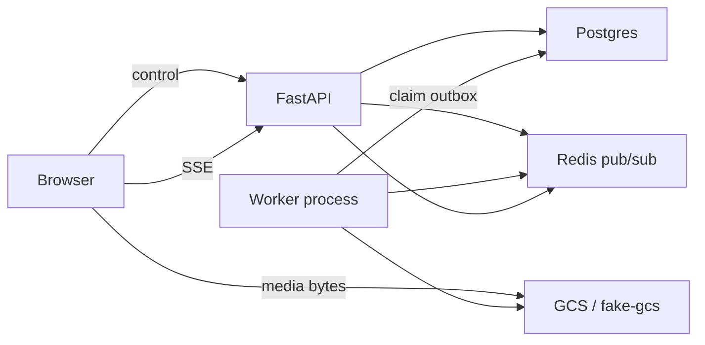

# Phase 3a architecture (as built)

Phase 3a is the code around the agent: probe, transcode, segment, a stub proposal, and a real ffmpeg render. No model is called. The product rules live in [hld-lld.md](hld-lld.md). This note is the shape that is actually in the repo, including the pieces that stay for phase 4.

## Processes

The browser talks to the API for control and to storage for the recording bytes. The API writes a run and an `outbox` row in one transaction. A worker later claims that row and does the slow work. Redis only announces what already committed (`run:{id}`). The open progress page hears it over `GET /runs/{id}/events`. A closed page reads the run row from Postgres on the way back.

## Upload

`POST /videos` inserts the video and returns a resumable upload session. The browser PUTs the file straight to storage in 8 MiB chunks. `POST /videos/{id}/uploaded` records `raw_uri` after the object exists. The API never holds the media bytes.

## The job note and the relay

Every status that has follow-up work inserts an `outbox` row in the same transaction as the status change. The row's `task_id` is `sha256(run_id:stage:attempt)`. Users do not poll this table.

`backend/app/pipeline/relay.py` is the delivery seam:

1. `claim` locks unsent rows (`FOR UPDATE SKIP LOCKED` plus a session advisory lock) and leaves `sent_at` null.
2. `run_in_process` calls `stages.handle` for each claimed row.
3. After `handle` returns, it sets `sent_at` and unlocks.
4. If the process dies first, the lock drops and `sent_at` stays null, so the next poll runs the same row again. `handle` continues only when the run is still at that stage's start status or its in-progress status.

`run_in_process` is the local stand-in. Pass `queues` when one process must not take every note. The compose service `worker` (profile `media`) runs `uv run python -m app.pipeline.worker` and claims only `pre-cpu` and `post-io` (ffmpeg). The agent queue is `uv run python -m app.pipeline.mac_agent` on the Mac, because Laya loads there. Plain `docker compose up` starts neither, so they do not race the API's `FAKE_WORKER` path. `FAKE_WORKER` still uses `FixtureEngines` and claims every queue.

Phase 4 keeps this file and changes step 2. The relay will call Cloud Tasks `create_task` with `name = task_id`, then set `sent_at`. Cloud Tasks, which is Google's HTTP task queue, stores the request and POSTs it to a worker. A repeated name is rejected, so a crash between create and commit does not run the stage twice. The worker's HTTP handler calls the same `stages.handle`. That client and that handler are not in this repo yet. See [Cloud Tasks](https://cloud.google.com/tasks/docs) and the "Outbox relay" section of [hld-lld.md](hld-lld.md).

## What a run does

| Status | Who | Work |
| --- | --- | --- |
| `queued` → `preprocessing` | `pre-cpu` | Probe, refuse a duration over 900 s, transcode, keyframes, scene segments, stub words. Write `runs.pre`. |
| `preprocessing` → `agent_running` | same stage's last transaction | Enqueues `agent`. |
| `agent_running` → `awaiting_review` or `approved` | `agent` | `stub_proposal`: one keep-all block over the real segments. Saves proposal v1. |
| `approved` → `postprocessing` → `done` | `post-io` | `fit_timeline`, ffmpeg, upload `final.mp4`, then the poster. The video becomes `ready`. |

Preprocess and render use three short transactions so ffmpeg does not hold the run row lock: mark the stage in progress and commit, run the engine with no database connection, then write the result and advance. The agent stage is still one transaction, because the stub does no slow work.

Approving in review mode (`POST /runs/{id}/approve`) is what inserts the `post-io` row. Auto mode inserts it when the proposal is saved, because that save moves the run straight to `approved`.

## After the proposal, what the user sees

1. The worker publishes `run.proposal_ready`. The progress page shows "Open review".
2. Review mode stops on `/runs/{id}/review`. Edits save a new proposal version. A stale `base_version` gets `409`.
3. Approve enqueues the render. The progress page follows `postprocessing`, then `run.done` with a signed playback URL.
4. The library and the share page read the same `output_uri` from Postgres.

Original-audio mode cuts the real WAV. AI-voice mode has a silent clip of the estimated duration inside `media.render`, and the stage never passes `voice`, so that branch does not run from the worker. `RunRef` has no voice field.

## Where the code lives

| Path | Role |
| --- | --- |
| `pipeline/stages.py` | Transactions and status moves. The only caller of `lifecycle.advance` from a worker. |
| `pipeline/relay.py` | Claim and the in-process stand-in. |
| `pipeline/worker.py` | Process entry. Builds `MediaEngines`. |
| `pipeline/engines.py` | `preprocess`, `propose`, `render`. Engines compute; they do not touch status. |
| `pipeline/media.py` | The only module that execs ffmpeg. |
| `pipeline/media_engines.py` | Live engines. `propose` is `stub_proposal`. |
| `pipeline/timeline.py`, `segment.py`, `words.py`, `proposal_stub.py` | Pure functions. |
| `pipeline/fixture_engines.py` | Tests and `FAKE_WORKER`. |
| `runs/lifecycle.py` | Compare-and-set, and the outbox row for the next status. |
| `runs/checks.py` | `edl_valid`. The review API and, in 3b, the orchestrator. |

## Still open for the 3a exit

- No real recording has been approved through the app on `MediaEngines`.
- AI voice is not wired from the stage.
- A kill mid-ffmpeg is covered by the redelivery rule and tested from status `preprocessing`, not by killing a process.
- Cloud Tasks is phase 4.
