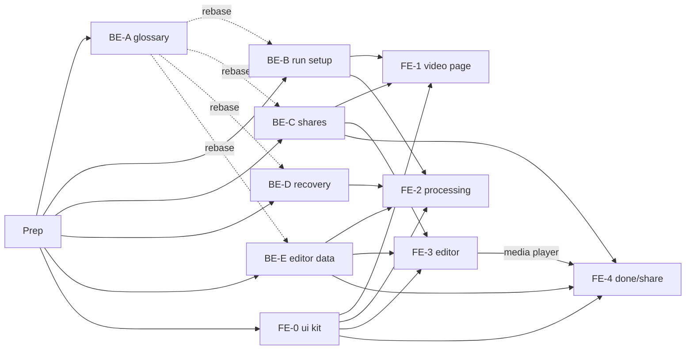

# Post-upload rework: workstreams

Status: ready to dispatch, 2026-10-27. Replaces `docs/plan/ui-implementation-spec.md` (now a pointer to this folder).

This folder turns the approved post-upload design into parallel workstreams. Each workstream doc is self-contained: a smaller agent gets one doc, the shared contracts, and the brief at the end of this file, and can work without reading the others.

- Design (source of truth for screens and copy): [../../design/ux-post-upload.md](../../design/ux-post-upload.md)
- Prototype: https://claude.ai/artifact/Xobc3e53GfLJnLi6SJeEvu (artboards Video, Processing, Editor, Share)
- Decisions D1 to D11: [../pre-phase4-decisions.md](../pre-phase4-decisions.md)
- Component research: [../../research/components-post-upload.md](../../research/components-post-upload.md)
- Shared API contracts for every workstream: [contracts.md](contracts.md)

## 1. Decisions taken in this rewrite

These settle the review findings on the old spec. The decisions below are settled for this implementation.

| # | Decision | Why |
|---|---|---|
| R1 | **Phase.** The agent and providers are committed (`8073152`). Phase 3b is underway: agent-side features are built now, together with their UI. | The old spec held a third of the work for a phase that has already started. |
| R2 | **Complete slices only.** A UI element merges to `main` only when its data is live on `main`. No hidden-until flags, no stored-but-unread columns, no fixture content in production. FE work waiting on a backend stays on its branch. | `pre-phase4-decisions.md` rule; the old Q1 merge rule shipped half slices. |
| R3 | **The backend builds the editor's change list.** `ProposalView` gains `changes`, `spots`, `chapters`, `script_lines` (contracts.md). The frontend does not infer labels from EDL and drop overlaps. | One source for the editor, processing banner and done screen. |
| R4 | **Needs-you spots come from the agent**, each with ordered fixes that are concrete patches. Choosing a fix edits the draft and saves through the existing `PUT /runs/{id}/proposal`. | D9; keeps one save path. |
| R5 | **Agent retry starts a fresh graph thread**: `thread_id = f"{run_id}:{attempt}"`. | A retry would otherwise resume the failed checkpoint once PostgresSaver lands. |
| R6 | **`retryable` comes from the exception**, not hard-coded `True`. Try again is shown only when `retryable` is true. | `_fail` always sends `True`; `transcribe` raises `retryable=False`. |
| R7 | **No hard-coded pause threshold.** "Long pauses" counts idle cuts the agent made. | "The agent decides" rule. |
| R8 | **Stub marker dropped** (old BE-13 and its migration). Production never runs the stub; dev mode shows the fixture. | YAGNI once the agent is live. |
| R9 | **Captions and struck-through words are not in this plan.** They need real word timings, which wait for ElevenLabs speech-to-text. They become part of that workstream. | Words are a timed stub today; building UI for them would be a half slice. |
| R10 | **Waveform peaks are computed in preprocess** and stored as a JSON object in GCS (object first, then the row). Spike S1 can overturn this. | Cheaper than computing on every proposal read. |
| R11 | **Voice list shows the OpenAI speech voices now** (real, used by the worker today), with committed sample files. | Phase 3b requires AI voice; the list is real data, not a placeholder. |
| R12 | **Raw share uses the same link model as cleaned shares** (anyone with the link, no expiry). | D5 "Loom mode"; only the raw-share part of BE-C waits on this. |
| R13 | **Undo is session-only**, and per-step time left is replaced by one overall estimate. | Design open question 4; no per-stage timing data. |
| R15 | **Do not build "Edit and re-render" after a run is done.** `run_transitions` has no edge out of `done`; the done screen offers "Clean again with other settings" only. | The backend has no supported way to reopen a completed run. |
| R14 | Citations name symbols (`lifecycle.advance`, `_fail`), not line numbers. | Line numbers broke on every edit of the old spec. |

## 2. Workstreams

| ID | Doc | Owns (summary) | Needs first |
|---|---|---|---|
| P | [00-prep.md](00-prep.md) | Commit docs, phase status, enum parser, migration numbers | none (serial, first) |
| BE-A | [be-a-glossary.md](be-a-glossary.md) | Remove workspace glossary, rename `glossary` to `key_terms` | P |
| BE-B | [be-b-run-setup.md](be-b-run-setup.md) | Fix options end to end, voices, run history, estimate | P |
| BE-C | [be-c-shares-media.md](be-c-shares-media.md) | Raw share, original playback URL, signed downloads | P (R12 settled) |
| BE-D | [be-d-run-recovery.md](be-d-run-recovery.md) | Retry, stale-task gate, fresh agent thread, safe failure text | P |
| BE-E | [be-e-editor-data.md](be-e-editor-data.md) | Changes, spots and fixes, chapters, script lines, peaks, progress events | P |
| FE-0 | [fe-0-ui-kit.md](fe-0-ui-kit.md) | Generic `ui/` primitives and `lib/clock.ts` | P |
| FE-1 | [fe-1-video-page.md](fe-1-video-page.md) | Record screen fix, video page | FE-0; BE-B, BE-C per element |
| FE-2 | [fe-2-processing.md](fe-2-processing.md) | Processing screen | FE-0; BE-D, BE-E, BE-B per element |
| FE-3 | [fe-3-editor.md](fe-3-editor.md) | Spikes S1 to S6, media player, timeline, editor | FE-0; BE-E, BE-C per element |
| FE-4 | [fe-4-done-share.md](fe-4-done-share.md) | Share card, raw card, done screen | FE-0; BE-C; FE-3 player |



### Waves (how to run agents in parallel)

| Wave | Run in parallel | Ends when |
|---|---|---|
| 1 | P (one agent) | P merged |
| 2 | BE-A, BE-B, BE-C (steps 1 to 2), BE-D, BE-E, FE-0, FE-3 spikes S1 to S6 | FE-0 merged (FE-0 is small; it gates the screen lanes) |
| 3 | FE-1, FE-2, FE-3 build, FE-4 share card; backend lanes continue | each FE element merges as its backend lands |
| 4 | FE-4 done screen (after FE-3's player), BE-C step 3 after R12 | all exit checks in each doc pass |

Up to seven agents at once in wave 2. Merge BE-A first: it renames across shared files, so the other backend lanes rebase onto it before opening their PR.

## 3. File ownership

One lane owns a file. Another lane may edit a shared file only in the section named here, appending rather than rewriting.

| File | Owner | Others may |
|---|---|---|
| `backend/app/contracts/pipeline.py` | BE-E | BE-A: rename the `glossary` field. BE-B: add `FixOptions` and `AgentState.fix_options` |
| `backend/app/contracts/enums.py` | BE-C | BE-E: none (no enum change) |
| `backend/app/contracts/events.py` | BE-E | BE-D: none (uses `RunFailedEvent` as is) |
| `backend/app/runs/schemas.py` | BE-B | BE-E: `ProposalView` fields only |
| `backend/app/runs/router.py` | BE-B | BE-D: the retry route. BE-E: `get_proposal` body only |
| `backend/app/runs/lifecycle.py` | BE-D | BE-B: `start` and a new `list_for_video`. BE-E: the `needs_you` count in `list_for_video` |
| `backend/app/pipeline/media.py`, `pipeline/timeline.py` | BE-E | none |
| `backend/app/runs/checks.py` | BE-E | BE-A: the rename. BE-B: one new check |
| `backend/app/runs/review.py` | BE-E | none (P makes the approve stage fix first) |
| `backend/app/pipeline/stages.py` | BE-D | BE-B: fix-options reader. BE-E: auto-approve line |
| `backend/app/pipeline/media_engines.py` | BE-E | BE-A: `synthesize` argument. BE-D: `thread_id` only |
| `backend/app/agent/**` | BE-E | BE-A: rename and prompt wording. BE-B: `initial_state` (fix options, voice) and the allowed-kinds input in `transcript_context`, `video_editor` and their prompts |
| `backend/app/videos/**` | BE-C | BE-B: `estimated_run_seconds` field and query |
| `backend/app/shares/**`, `shared/storage/**` | BE-C | none |
| `backend/openapi.json`, `frontend/src/api/generated/schema.d.ts` | everyone | never hand-merge: on conflict, take main's copy and regenerate |
| `frontend/src/ui/**` | FE-0 | FE-3: `media-player.tsx`, `timeline.tsx` |
| `frontend/src/lib/**` (not `server/`) | FE-0 | FE-3: `cut-map.ts` |
| `frontend/src/app/globals.css` | FE-0 | none (FE-0 adds `--color-link` only) |
| `frontend/src/features/videos/**`, `features/recorder/**` | FE-1 | none |
| `frontend/src/features/runs/**`, `frontend/src/api/events.ts` | FE-2 | none |
| `frontend/e2e/*.spec.ts` | the lane named in each FE doc | FE-1: selector strings for copy it renames |
| `frontend/e2e/fixtures/**` | FE-3 (`proposal-demo.json`) | each FE lane adds its own fixture files |
| `frontend/src/features/review/**` | FE-3 | none |
| `frontend/src/features/shares/**`, `frontend/src/app/(app)/videos/[id]/**`, `frontend/src/app/s/**` | FE-4 | none |

### Migration numbers (reserved; do not renumber)

| File | Lane |
|---|---|
| `06_key_terms.sql` | BE-A |
| `07_drop_glossary_terms.sql` | BE-A |
| `08_share_kind.sql` | BE-C |
| `09_spots_fix_chosen.sql` | BE-E |
| `10_run_fix_options.sql` | BE-B |
| `11_runs_started_at_grant.sql` | BE-D |

`migrate.py` applies every unrecorded file in name order, so lanes can merge in any order. Never edit a file after it is merged.

## 4. Rules every lane follows

From `CLAUDE.md` (read it): tenancy via `set_config(..., true)` in one transaction; new tables need `workspace_id`, ENABLE and FORCE RLS, policies, grants and RLS tests; run status changes only through `lifecycle.advance`; enqueues are outbox rows in the same transaction; GCS object before row; LangGraph holds only the agent; code enforces only mechanical limits.

Frontend: `frontend/scripts/check-layout.mjs` is not edited. Six feature folders; features never import each other; `ui/` imports only `ui/` and `lib/`; network calls only in `src/api`; no barrels; kebab-case files. Copy follows `ux-post-upload.md` exactly, no em-dashes, no internal names (D3).

Checks before a PR:

```bash
# backend/
uv run ruff check . && uv run ruff format --check . && uv run python scripts/check_layout.py \
  && uv run pyright && uv run python scripts/check_db.py && uv run pytest \
  && uv run python scripts/export_openapi.py --check
# frontend/
npm run gen:api && npm run check && npm run build && npm run e2e
```

## 5. Rendering and visual check (frontend lanes)

**Run the app.** Full stack, as in the repo `README.md` "Local development". For UI work you usually do not need the agent or ffmpeg: start the API with the fixture worker, which runs every stage in-process with canned output.

```bash
docker compose up -d                                   # Postgres, Redis, fake GCS
cd backend && uv run python scripts/migrate.py --dev-passwords
FAKE_WORKER=true uv run uvicorn app.main:app --reload --port 8000
cd frontend && npm run dev                             # http://localhost:3000
```

Sign up at `/sign-up`, then record a short clip at `/record` (Chrome), or create a video with the `createUploadedVideo` helper pattern in `frontend/e2e/helpers.ts`.

**Show states the backend cannot produce yet.** In Playwright, sign up for real (`signUp` helper), then `page.route("**/api/...", route => route.fulfill({ json }))` for the endpoints your screen reads. Keep fixtures in `frontend/e2e/fixtures/*.json`, shaped by the generated types (or by contracts.md until the backend merges). Use the demo scenario from `ux-post-upload.md` section 5 so screens compare one to one with the prototype. Fixtures never ship in `src/`.

**Compare with the prototype.** Open the artboard named in your doc at https://claude.ai/artifact/Xobc3e53GfLJnLi6SJeEvu next to your page at the same width. Check, in order: layout and column order, copy (exact), type sizes and weights, spacing, colours, every state the doc lists. The prototype uses inline styles; map them to the tokens listed in `fe-0-ui-kit.md` rather than copying hex values. Where the prototype and the doc disagree, the doc wins; say so in the PR.

**Screenshots for the PR.** Each screen lane's e2e spec saves full-page screenshots at 1440 x 900 and 390 x 844 for each listed state (`await page.screenshot({ path: "test-results/<screen>-<state>-<width>.png", fullPage: true })`) and attaches them to the PR. Do not commit them and do not add snapshot assertions.

**Accessibility pass.** Keyboard only through every control; visible focus; one polite live region per screen; `npx @axe-core/cli http://localhost:3000/<route>` or an axe check in the spec with zero serious issues.

## 6. Brief for a workstream agent

Paste this, filling the two placeholders:

```text
You are implementing workstream <ID> of the Stepwise post-upload rework, in the repo at <path>.

Read, in order:
1. CLAUDE.md
2. docs/plan/post-upload/README.md sections 1, 3 and 4 (decisions, file ownership, rules), and section 5 if you are a frontend lane
3. docs/plan/post-upload/contracts.md
4. docs/plan/post-upload/<your doc>.md (your task; follow its steps in order)
5. Only the code files your doc names. Do not read the other workstream docs.

Rules:
- Edit only files your lane owns, or the named section of a shared file (README section 3).
- Work on branch ws/<id>-<step>. One PR per step group your doc lists; each PR passes the checks in README section 4.
- Merge a UI element only when its backend data is on main. Until then, build it against page.route fixtures in tests.
- If a contract in contracts.md does not fit the code, stop and report. Do not change the contract yourself.
- If a step needs a decision marked "confirm" that is not settled, skip that step and report it.

When done, report: steps finished, PRs opened, check output (pass or the failing lines), and anything you skipped and why.
```
